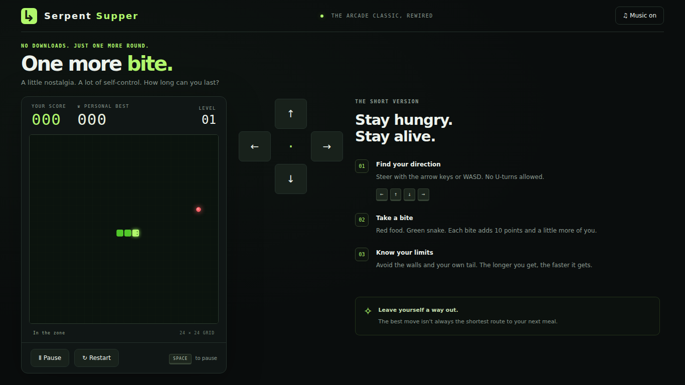

# Serpent Supper

[Play Serpent Supper](https://nateofspades.github.io/Serpent_Supper_Game/)



Eat, grow, and leave yourself a way out. A responsive browser-only arcade game with a 24 × 24 arena, rounded luminous snake, glowing food, personal bests, large touch controls and an instrumental electronic score. No accounts, ads, tracking, backend or runtime dependencies.

The screenshot above is captured from an actually started and moved game, without injected scores or positions. The capture harness freezes time only during image encoding; separate native Web Audio tests use the real clock and signal. See [TESTING.md](TESTING.md) for reproducible coverage and limitations and [the IP assessment](docs/IP_AUDIT.md) for provenance, licensing and comparison evidence. No legal clearance or physical-device/speaker certification is claimed.

No build step is needed. Pages deploys an allowlisted static runtime: `index.html`, `styles.css`, `app.js`, `engine.js`, `music.js`, `favicon.svg`, `.nojekyll`, `LICENSE` and the own gameplay image. Tests, tooling, private preparation documents and external evidence are not deployed.

## Features

- Food adds 10 points and a body segment; pace rises as the snake grows.
- Wall/self collision ends a round; filling the board wins.
- Pause/resume, instant restart, two buffered legal turns and no direct reversals.
- Persisted personal best and music preference, with session-only fallback when storage is blocked.
- Portrait/landscape D-pad and viewport-fit arena; no page scrolling during play.

## Controls

### Desktop

- Select **Start Game**, then steer with the **arrow keys** or **WASD**.
- Press **Space** with gameplay focus or select **Pause / Resume** to pause and continue. On a focused button, Space activates that button normally.
- **Restart** begins a new run immediately; **Play Again** starts over after a loss.
- Direct reversals are rejected. Up to two legal turns can be buffered and are applied one per game tick.

### Mobile and touch

- Select **Start Game**, then use the four large directional buttons below the board in portrait or beside it in short landscape view.
- The page and game surface suppress browser scrolling and touch panning while playing.
- The layout keeps the board, controls, Music toggle, and gameplay actions visible at practical phone, tablet, laptop, and desktop viewports.

Each red food pickup adds 10 points and one body segment. The 24 × 24 board starts at a 155 ms tick and accelerates to a 65 ms minimum. The personal best is stored under the original `neon-snake-best` localStorage key so existing scores remain compatible.

## Music

**Neon Circuit** is the original instrumental synthwave/electronic background score composed programmatically for this project. It is synthesized at runtime with the Web Audio API; it contains no samples, recordings, generated audio files, or third-party musical assets. Copyright © 2026 Nathan Burns and licensed under this repository's MIT License.

Music starts only after a user interaction. **Music on / off** is persisted under `neon-snake-music`; muting preserves the loop position. The single music controller is reused across start, restart, menu, game over, resize and orientation changes. Gameplay pause suspends the existing audio context at its current transport position; Resume continues that context without changing the enabled preference. Page visibility and interrupted/closed/unavailable audio are handled without creating simultaneous duplicate tracks. Food, loss, and button sound effects are intentionally absent.

## Run locally

The game itself needs only a static HTTP server because it uses native ES modules:

```sh
python3 -m http.server 4380 --bind 127.0.0.1
```

Open <http://127.0.0.1:4380/>. `npm run serve` starts the same loopback-only server. Use your own server, not an unrelated checkout on another port.

## Install and test

Automated tests require Node.js 22+ and npm:

```sh
npm ci
npx playwright install chromium
npm test
```

For browser and responsive suites, keep the local server running in another terminal:

```sh
BASE_URL=http://127.0.0.1:4380 npm run test:browser
BASE_URL=http://127.0.0.1:4380 npm run test:layout
# or, after starting the server:
BASE_URL=http://127.0.0.1:4380 npm run test:all
```

On minimal Linux installations, use `npx playwright install --with-deps chromium`. Browser coverage is Chromium and mobile coverage uses browser touch emulation, not physical-device certification. See [TESTING.md](TESTING.md) for the test matrix and current verification details.

The expanded six-viewport acceptance suite, including native audio, can run separately:

```sh
BASE_URL=http://127.0.0.1:4380 npm run test:acceptance
```

## Project files

- `index.html` — accessible game, music, action, and direction controls.
- `styles.css` — viewport-fit responsive design and touch-scroll suppression.
- `engine.js` — deterministic, DOM-independent game rules.
- `app.js` — rendering, input, timing, storage, and UI integration.
- `music.js` — original procedural score and resilient Web Audio lifecycle.
- `tests/*.test.js` — Vitest unit/interface tests and Playwright browser/layout suites.
- `.github/workflows/test.yml` — CI for pushes to `main` and pull requests.

All game references use relative URLs (`./app.js`, `./music.js`, `./styles.css`, and `./favicon.svg`); the README image is `assets/gameplay.png`. The final hosted path is [Serpent_Supper_Game](https://nateofspades.github.io/Serpent_Supper_Game/). Origin-wide legacy storage keys are retained for the path-only move; seeded path compatibility tests are not proof of real-user migration.

## Browser notes

Canvas 2D, ES modules, CSS Grid, and Web Audio are used where available. If localStorage is blocked, scores and music preferences become session-only. If Web Audio is missing or cannot resume, gameplay remains functional. Scores and preferences are origin-specific and do not sync between devices.

## Technology and credits

The existing [MIT notice](LICENSE) credits **Nathan Burns (2026)**; it is preserved, not replaced with a new general license. The geometric art, engine and **Neon Circuit** implementation are retained. Git history includes assisted initial creation; authorship notices are not independent proof of chain of title or musical originality. See [docs/IP_AUDIT.md](docs/IP_AUDIT.md). Runtime code is native HTML/CSS/ES modules, Canvas and Web Audio with no framework or backend. Vitest, Playwright, jsdom and Prettier are development/test dependencies with their own licenses, inventoried in [docs/dependency-license-inventory.json](docs/dependency-license-inventory.json). Do not redistribute their installations or browser binaries under the game's MIT notice.
